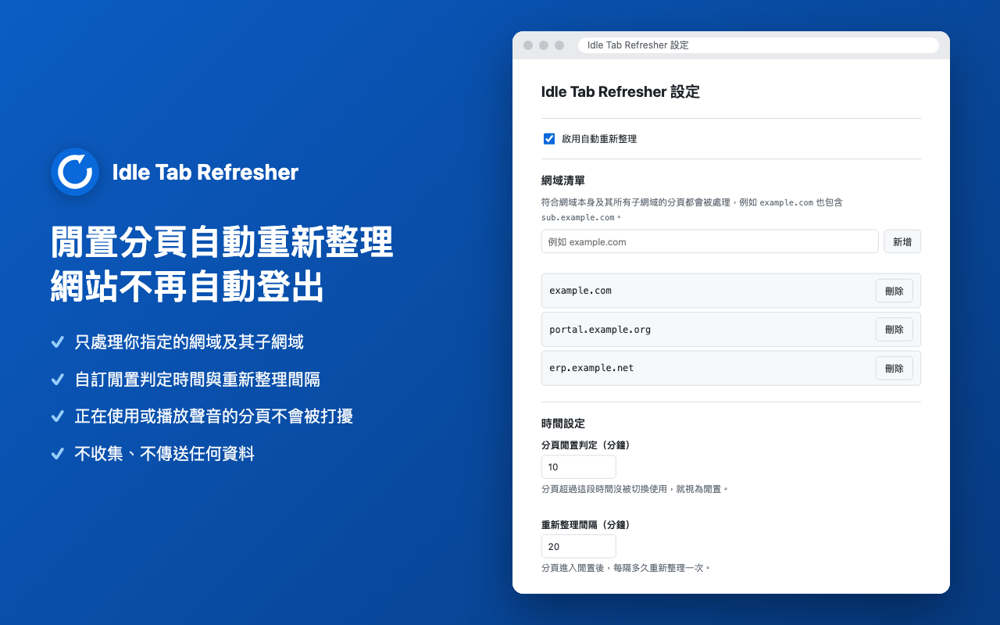
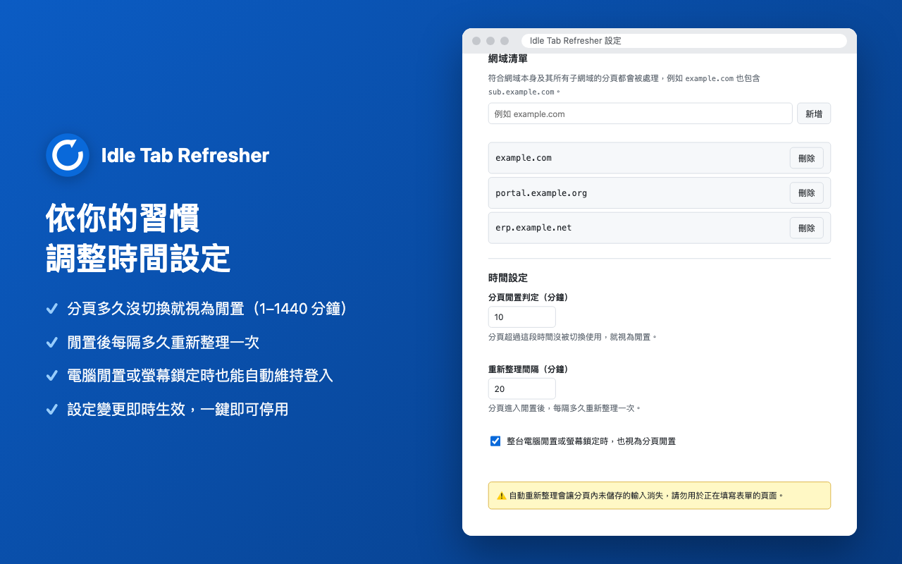
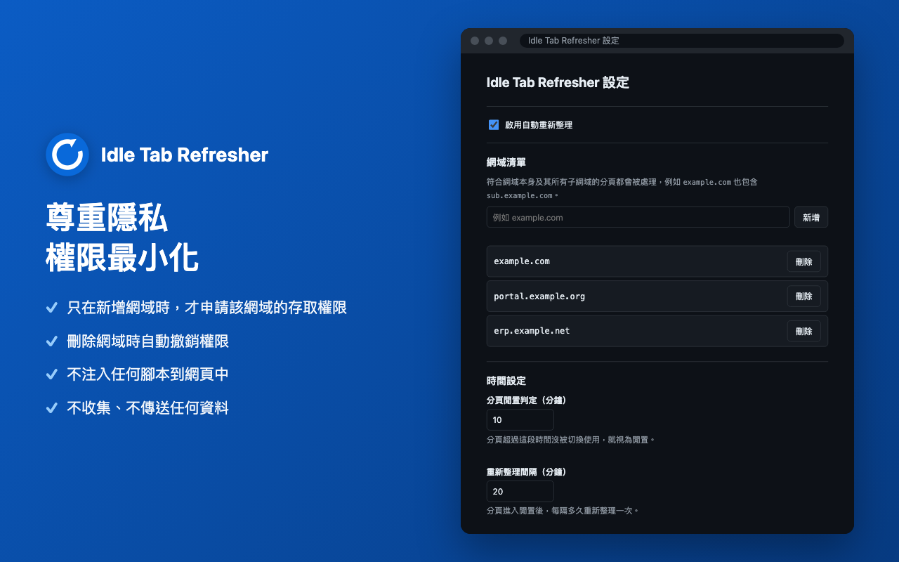

# Idle Tab Refresher

某些網站閒置太久會自動登出。這個 Chrome 擴充功能會在你指定網域的分頁「沒在使用」超過設定時間後，自動重新整理該分頁，以維持登入狀態。



<table>
  <tr>
    <td></td>
    <td></td>
  </tr>
</table>

## 專案結構

```
├── idle-tab-refresher/   # 擴充功能本體（manifest.json 所在處）
├── tests/                # lib/domain.js、lib/settings.js 的單元測試
├── docs/screenshots/     # 商店截圖（1280×800，24 位元 PNG）
└── package.json          # 僅供 npm test 使用
```

## 安裝

1. 開啟 `chrome://extensions`。
2. 開啟右上角的「開發人員模式」。
3. 點「載入未封裝項目」，選擇 `idle-tab-refresher/` 資料夾（`manifest.json` 所在的資料夾，不是 repo 根目錄）。
4. 需要 Chrome 121 以上版本。

## 打包上架

在 repo 根目錄執行，產生可上傳到 Chrome Web Store 的 zip（`manifest.json` 位於 zip 最上層）：

```bash
cd idle-tab-refresher && zip -r -X ../idle-tab-refresher-1.0.0.zip . -x "*.DS_Store"
```

每次上傳新版前，先調高 `idle-tab-refresher/manifest.json` 的 `version`，並修改 zip 檔名中的版本號。

## 使用方式

點工具列上的擴充功能圖示即可開啟設定頁。所有變更都會即時儲存。

| 設定 | 說明 |
|---|---|
| 啟用自動重新整理 | 總開關。關閉後完全不會重新整理任何分頁。 |
| 網域清單 | 要處理的網域。輸入 `example.com`、`https://www.example.com/path`、`*.example.com`、`localhost:3000` 等格式都可以，會自動整理成純主機名稱（例如 `example.com`）。網域本身與其所有子網域都會被處理（`sub.example.com` 符合 `example.com`，但 `notexample.com` 不符合）。新增時 Chrome 會詢問是否授權存取該網域；拒絕則不會加入。刪除網域時會一併撤銷權限。 |
| 分頁閒置判定（分鐘） | 分頁超過這段時間沒被切換使用（且不是目前聚焦視窗的前景分頁），就視為閒置。範圍 1–1440，預設 10。 |
| 重新整理間隔（分鐘） | 分頁閒置後，每隔多久重新整理一次。同一分頁在此間隔內最多重新整理一次。範圍 1–1440，預設 20。 |
| 整台電腦閒置或螢幕鎖定時，也視為分頁閒置 | 開啟時，若整台電腦超過「分頁閒置判定」時間沒有操作或已鎖定螢幕，連前景分頁也會被重新整理。預設開啟。 |

### 什麼時候不會重新整理

- 你正在使用的分頁（聚焦視窗中的前景分頁）且電腦有在操作時。
- 分頁正在播放聲音時。
- 非 `http` / `https` 的分頁（例如 `chrome://`、`file://`）。

### 測試建議

把兩個時間都設為 1 分鐘即可快速驗證。若要看每次檢查的判斷過程，將 `idle-tab-refresher/background.js` 開頭的 `DEBUG` 改為 `true`，並在 `chrome://extensions` 點本擴充功能的「Service Worker」開啟 DevTools。

網域處理的單元測試（需 Node 18+），在 repo 根目錄執行：

```bash
npm test
```

## 已知限制

- **重新整理會清掉分頁內未儲存的輸入。** 請勿用於正在填寫表單的頁面。
- 若網站有「絕對逾時」（例如登入後固定幾小時一定登出），重新整理無法延長登入時間。
- 判斷「分頁有沒有在使用」只依據分頁最後被切換到的時間與整機閒置狀態，不會偵測分頁內的滑鼠／鍵盤操作。若你在一個沒有聚焦的視窗中長時間閱讀某分頁，它仍可能被重新整理。
- 以「載入未封裝項目」安裝時，Chrome 重新啟動後可能會提示停用開發人員模式的擴充功能，請選擇保留。
- 若在 `chrome://extensions` 手動撤銷了某網域的權限，該網域在設定頁會標示「未授權」，可點「重新授權」恢復。

## 隱私聲明

本擴充功能不收集、不傳送任何資料，不連線到任何外部伺服器，也不使用遠端程式碼。設定只儲存在 Chrome 的 `chrome.storage`（會隨你的 Google 帳號同步）。
